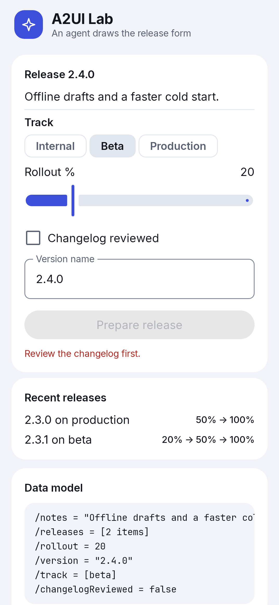
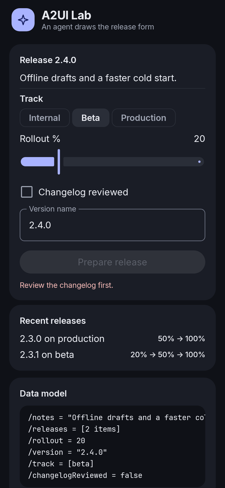
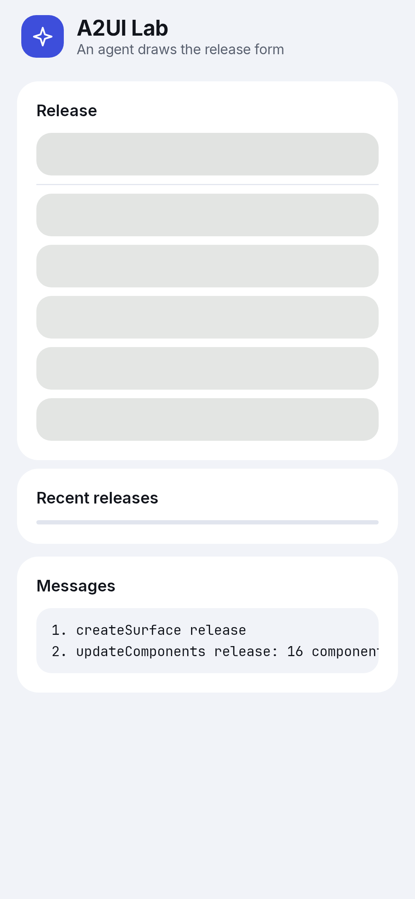
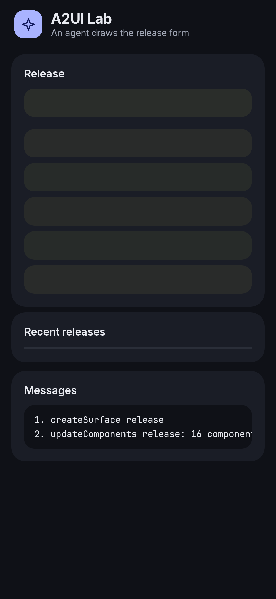
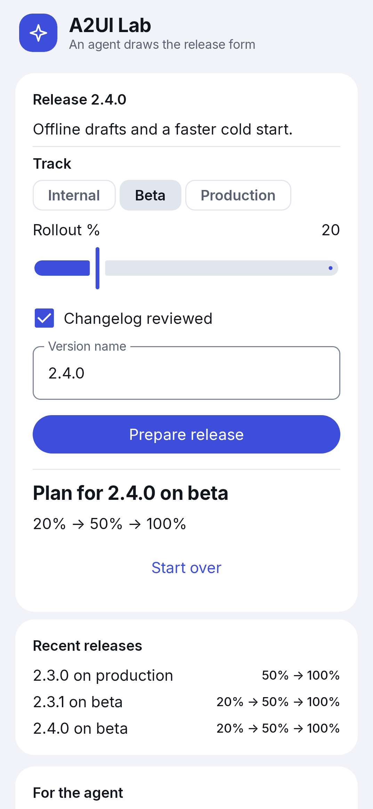
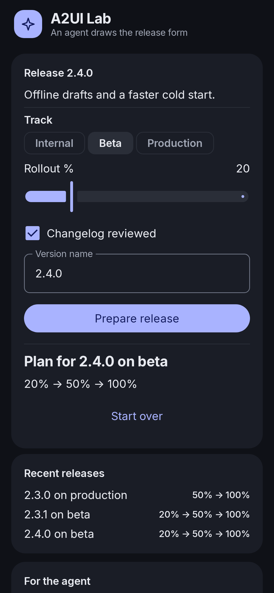
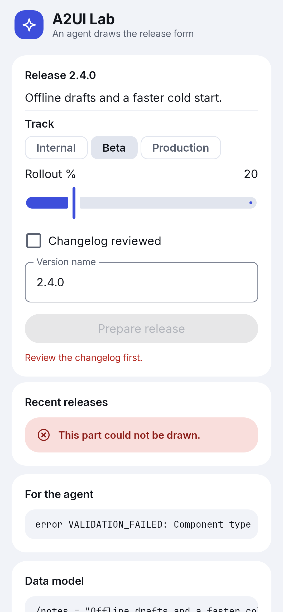
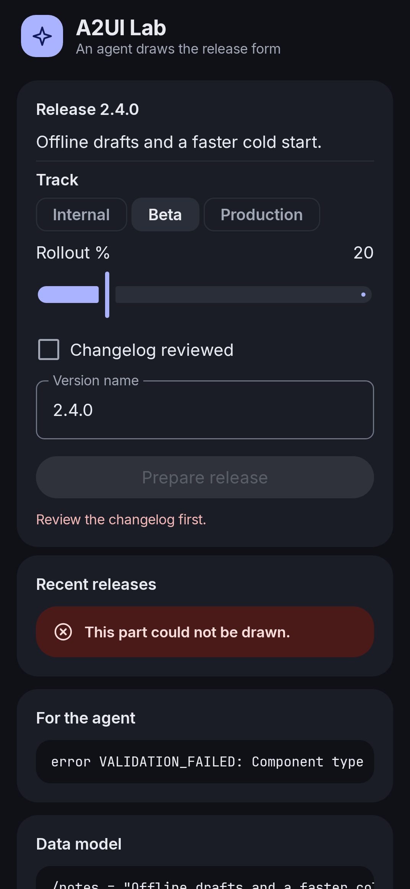

# A2UI Lab

A simulated agent draws a release form in Jetpack Compose through the A2UI protocol.

 [](LICENSE)

An Android app that renders the screen an agent describes. A simulated agent sends A2UI messages as JSON, the AndroidX libraries validate them and draw native Compose components, and what the user does goes back to the agent as an event.

There is no model and no network: the agent is a Kotlin class inside the app, so the project is about the client side of the protocol.

<table>
<tr>
<td align="center"><b>The form the agent draws</b><br> </td>
<td align="center"><b>The layout has arrived, the data has not</b><br> </td>
</tr>
<tr>
<td align="center"><b>The agent answers with a plan</b><br> </td>
<td align="center"><b>A List is refused and the app keeps running</b><br> </td>
</tr>
</table>

## Why it matters

An agent that composes a screen is only useful if the app stays in control. A message can be valid for the protocol and still break the host: `List` in the Basic Catalog is a lazy list, so sending one into a screen that scrolls crashes the app with an `IllegalStateException`.

## How it works

The catalog decides what an agent may ask for. This app offers an allow list of ten components, and one of them is its own card: the kit's `SectionCard` wrapped as an A2UI component. The wrapper only translates properties into arguments, so the look stays in the kit.

Anything outside the list is refused before it reaches the UI: that part of the screen shows an error state, the rest keeps working, and an error message is ready for the agent.

```kotlin
    @Composable
    override fun A2uiComponentScope.Content(
        properties: A2uiComponentProperties,
        modifier: Modifier,
    ) {
        // The validator has already refused any message without a child.
        val childId = checkNotNull(properties[ChildProperty])
        SectionCard(modifier = modifier, title = properties.bind(TitleProperty)) {
            when (val child = observeA2uiComponentState(childId)) {
                // The agent has not sent the child yet, or the child waits for its data.
                is A2uiComponentState.Loading ->
                    LinearProgressIndicator(modifier = Modifier.fillMaxWidth())
                // The validator refused the child; the processor reports why in an error message.
                is A2uiComponentState.Error ->
                    StatusBanner(
                        text = stringResource(R.string.lab_card_error),
                        status = Status.Error,
                    )
                is A2uiComponentState.Success -> A2uiComponent(component = child.component)
            }
        }
    }
```

From [`SectionCardComponent.kt`](app/src/main/java/io/github/cixweb/a2uilab/a2ui/SectionCardComponent.kt#L48-L69), lines 48-69.

## Code map

Sources are under `app/src/main/java/io/github/cixweb/a2uilab/`.

```text
a2ui/                                                  The catalog, the custom card and the bridge to the agent
ui/                                                    The screen and its state
agent/src/main/kotlin/io/github/cixweb/a2uilab/agent/  The simulated agent, with no Android dependency
contract/                                              What the agent reads to know the catalog
```

### `a2ui/`

- **[`LabCatalog.kt`](app/src/main/java/io/github/cixweb/a2uilab/a2ui/LabCatalog.kt)**: The allow list of components the agent may use
- **[`SectionCardComponent.kt`](app/src/main/java/io/github/cixweb/a2uilab/a2ui/SectionCardComponent.kt)**: The kit's card as an A2UI component
- **[`AgentBridge.kt`](app/src/main/java/io/github/cixweb/a2uilab/a2ui/AgentBridge.kt)**: Translates a button event from the library's type to the agent's
- **[`Inspector.kt`](app/src/main/java/io/github/cixweb/a2uilab/a2ui/Inspector.kt)**: Feeds the panels that show the traffic and the data model
- **[`SettledSurfaces.kt`](app/src/main/java/io/github/cixweb/a2uilab/a2ui/SettledSurfaces.kt)**: Runs messages to the end, for previews and tests

### `ui/`

- **[`LabScreen.kt`](app/src/main/java/io/github/cixweb/a2uilab/ui/LabScreen.kt)**: What the agent drew, and the panels around it
- **[`LabViewModel.kt`](app/src/main/java/io/github/cixweb/a2uilab/ui/LabViewModel.kt)**: Connects the message processor to the agent, in both directions

### `agent/src/main/kotlin/io/github/cixweb/a2uilab/agent/`

- **[`Agent.kt`](agent/src/main/kotlin/io/github/cixweb/a2uilab/agent/Agent.kt)**: The interface a real backend would implement
- **[`ReleaseAgent.kt`](agent/src/main/kotlin/io/github/cixweb/a2uilab/agent/ReleaseAgent.kt)**: Draws the form and answers its button
- **[`ReleaseForm.kt`](agent/src/main/kotlin/io/github/cixweb/a2uilab/agent/ReleaseForm.kt)**: The components of the form, as the JSON an agent would send
- **[`RolloutPlan.kt`](agent/src/main/kotlin/io/github/cixweb/a2uilab/agent/RolloutPlan.kt)**: The sample rule that computes the rollout stages
- **[`A2uiMessages.kt`](agent/src/main/kotlin/io/github/cixweb/a2uilab/agent/A2uiMessages.kt)**: Builds the A2UI envelopes, so user text cannot break a message

### `contract/`

- **[`catalog.schema.json`](contract/catalog.schema.json)**: The JSON Schema of the catalog; a test keeps it equal to the app

## Try it

Requirements: JDK 17 and the Android SDK.

```bash
git clone https://github.com/cixweb/a2ui-lab.git
cd a2ui-lab
./gradlew installDebug
```

Once it is running:

- Tap Ask the agent, tick Changelog reviewed and tap Prepare release: the plan appears and a row joins Recent releases
- Type in Version name: the title of the card follows as you type
- Tap Start over, then Ask the agent again: the form opens with the new row still in Recent releases

## Verification

Unit tests and screenshot tests:

```bash
./gradlew testDebugUnitTest
./gradlew validateDebugScreenshotTest
```

## Dependencies

Kotlin, Jetpack Compose and Material 3. Versions, all pinned in `gradle/libs.versions.toml`: `agp` 9.4.1, `kotlin` 2.4.21, `compose-bom` 2026.09.00, `a2ui` 1.0.0-alpha02, `activity-compose` 1.13.0, `lifecycle` 2.11.0, `core-ktx` 1.19.1, `junit` 4.13.2, `screenshot` 0.0.1-alpha16, `gson` 2.15.0, `kotlinx-coroutines` 1.9.0, `kotlinx-serialization` 1.7.3.

## Caveats

- The agent is simulated: no model, no network, one fixed form. It does not understand the user's words.
- Validation errors do not reach the simulated agent. They stay in the For the agent panel, so nothing repairs a refused component.
- The agent's memory is one list in one object: it serves one client and is lost when the app closes.
- No button in the app asks for a refused component: a test and a screenshot send the `List` by hand.
- The A2UI libraries are 1.0.0-alpha02 and pull in Compose 1.13 and Material 3 1.5 alphas, for the whole app.
- The repository has no CI: the build and the tests were run on my machine, from a clean export of this commit.

## License

MIT, see [LICENSE](LICENSE).
